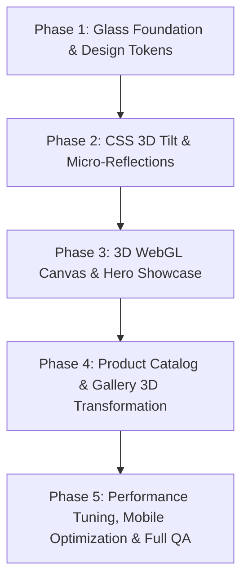

# FTS Store: 3D Animated Glassmorphism Architecture & Design Plan
**Document Version:** 1.0.0  
**Status:** Under Review / Awaiting User Approval  
**Authors:** Senior Frontend Architect, 3D Web Developer, Glassmorphism UI Designer, QA Engineer  
**Target Platform:** Frnds Tech Solution (FTS) E-Commerce Platform  
**Target Visual Identity:** Futuristic Cyber-Electronics Glassmorphism (Deep Navy, Electric Blue, Radiant Cyan, Specular White)

---

## 1. Executive Summary & Project Objectives

Frnds Tech Solution (FTS) Store is an e-commerce platform dedicated to high-performance electronics, computing hardware, audio gear, and smart lifestyle devices. The objective of this initiative is to elevate the existing store into a **state-of-the-art 3D animated glassmorphism web experience** that rivals top-tier hardware showcases (such as Apple, Nothing, and Razer) while preserving lightning-fast load times, flawless e-commerce checkout flows, and 100% test pass rates.

### Primary Directives:
1. **Visual Excellence & Wow Factor:** Frosted translucent glass panels, luminous neon borders, subtle chromatic edge reflections, layered depth, and deep cosmic navy backdrop (`#020617`).
2. **3D Depth & Immersion:** 3D interactive hero models, gyroscopic/mouse-driven card tilt with specular highlights, and an ambient particle/nebula canvas.
3. **Graceful Progressive Enhancement:** 3-tier graphics fallback architecture ensuring 60 FPS on high-end desktop rigs, mobile phones, and virtualized/low-spec environments without WebGL crashes.
4. **Zero Regression:** All existing shopping cart, guest checkout, wishlist, customer authentication, and admin workflows must remain 100% operational.

---

## 2. Current Architecture & Codebase Inspection

A comprehensive static and runtime inspection of the existing workspace was conducted:

### 2.1 Technology Stack Matrix
| Layer | Existing Technology | Version | Assessment |
|---|---|---|---|
| **Frontend Framework** | React + React DOM | 18.2.0 | Excellent compatibility with React Three Fiber v8 and Framer Motion v14. |
| **Build & Dev Tool** | Vite | 5.1.6 | Fast HMR, supports GLSL shader loaders and dynamic chunking. |
| **Language** | TypeScript | 5.2.2 | Strict typing across components, context, and catalog schemas. |
| **Styling Engine** | Tailwind CSS + Custom CSS | 3.4.1 | Tailwind base with initial `.glass-*` classes in `index.css`. |
| **Animation Engine** | Framer Motion | 14.2.0 | Spring physics, layout animations, exit transitions. |
| **Micro-Effects** | Canvas-Confetti, Lucide-React | 1.9.4 / 0.363.0 | Lightweight particle bursts and modern iconography. |
| **Client Routing** | React Router DOM | 6.22.3 | Client-side routing with nested `AppLayout`. |
| **Backend API** | FastAPI + SQLite + SQLAlchemy | 0.104+ | 87 pytest unit tests passing; 59 live QA end-to-end tests passing. |

### 2.2 Client Routing Architecture
All routes are defined in [`frontend/src/App.tsx`](file:///d:/projects_demo/e-commers/frontend/src/App.tsx):
- `/`: **HomePage** — Hero promotional banner, category shortcuts, customer benefits grid, featured products, deals of the day, best sellers, testimonials, newsletter strip.
- `/products`: **ProductsPage** — Search, category pills, price filtering, sorting, pagination, and stock badges.
- `/products/:idOrSlug`: **ProductDetailPage** — Multi-image gallery, specs, quantity selector, add-to-cart, buy now, related products.
- `/cart`: **CartPage** — Cart line items, promo code engine, shipping threshold calculator, order summary.
- `/checkout`: **CheckoutPage** — 3-step checkout (Customer Info, Shipping Address, Payment Method).
- `/login` & `/register`: **Auth Pages** — Glassmorphic login/registration cards with JWT persistence.
- `/profile`: **ProfilePage** (Protected) — Customer order history and profile details.
- `/orders` & `/orders/:orderNumber`: **Orders Pages** — Real-time tracking and invoice detail.
- `/admin`: **AdminPage** (Admin Protected) — Product catalog, categories, orders, coupons, and sales analytics.

### 2.3 State Management & Services
- **`AuthContext`** ([`frontend/src/context/AuthContext.tsx`](file:///d:/projects_demo/e-commers/frontend/src/context/AuthContext.tsx)): Handles JWT token storage, customer login/register/logout, and `/api/v1/auth/me` profile syncing.
- **`CartContext`** ([`frontend/src/context/CartContext.tsx`](file:///d:/projects_demo/e-commers/frontend/src/context/CartContext.tsx)): Hybrid session management using guest `X-Session-ID` header and authenticated user ID, automatic subtotal, tax calculation, shipping tier evaluation, and slide-over drawer state.
- **`WishlistContext`** ([`frontend/src/context/WishlistContext.tsx`](file:///d:/projects_demo/e-commers/frontend/src/context/WishlistContext.tsx)): LocalStorage persistence synced with customer identity.
- **`ApiClient`** ([`frontend/src/services/api.ts`](file:///d:/projects_demo/e-commers/frontend/src/services/api.ts)): Centralized fetch client handling bearer tokens, session IDs, standard error formatting, and query serialization.

---

## 3. Live Browser Inspection & Baseline Verification

The live frontend (`http://localhost:3000`) and backend (`http://127.0.0.1:8000`) were inspected via Chrome DevTools Protocol (CDP) automated harness:

### 3.1 Live Inspection Metrics
- **Viewport Dimension:** 1424 × 805 px (Desktop)
- **DOM Root Mounted:** Yes (`#root`)
- **Homepage `<h1>` Headline:** *"Upgrade Your Life with FTS Store"*
- **Header & Navigation:** Verified present with search, departments, wishlist, cart, and authentication controls.
- **DOM Sections Detected:** 10 structural sections mounted.
- **Product Cards Rendered:** 5 primary article cards rendered in the viewport baseline.
- **HTTP Network Failures:** 0 (all API calls and image requests returned 200 OK).
- **Baseline Screenshot:** Successfully captured and verified at [`scratch/homepage_glass_baseline.png`](file:///d:/projects_demo/e-commers/scratch/homepage_glass_baseline.png).

### 3.2 WebGL & Hardware Acceleration Baseline
- **WebGL 1 Support:** **Supported (`true`)**
- **WebGL 2 Support:** **Disabled/Unavailable (`false`)** in virtualized/software-rendered environments.
- **Renderer String:** `ANGLE (Microsoft, Microsoft Basic Render Driver (0x0000008C) Direct3D11 vs_5_0 ps_5_0, D3D11)`
- **Architectural Consequence:** WebGL 2 shaders and advanced post-processing passes (e.g. Screen Space Reflections, Bloom passes with high kernel weights) will crash or severely lag on machines without dedicated GPU acceleration. A **progressive 3D enhancement architecture** is mandatory.

### 3.3 Existing Technical Debt & Bugs Identified
1. **React Router v7 Deprecation Warnings:**
   - `⚠️ React Router Future Flag Warning: React Router will begin wrapping state updates in React.startTransition in v7.`
   - `⚠️ React Router Future Flag Warning: Relative route resolution within Splat routes is changing in v7.`
2. **Flat 2D Product Imagery:** Hero banner and product cards use static 2D photograph tiles without dynamic depth, specular lighting, or cursor interaction.
3. **Static Glass Panels:** Existing `.glass-card` and `.glass-panel` utilities use uniform opacity without chromatic aberration, dynamic border specular highlights, or refractive noise textures.
4. **Hero Image Carousels Lack 3D Depth:** Switching slides is a standard horizontal slide without perspective z-axis separation or parallax depth layering.

---

## 4. Visual Target & Glassmorphism Design System

The visual theme for Frnds Tech Solution (FTS) is **Futuristic Cyber-Electronics Glassmorphism**.

### 4.1 Color Architecture & Palette Tokens
```css
:root {
  /* Deep Space Canvas */
  --fts-bg-space: #020617;          /* Slate 950 ultra-deep foundation */
  --fts-bg-surface: #0a0f1d;        /* Deep navy foundation */
  --fts-bg-elevated: #0f172a;       /* Slate 900 panel base */

  /* Electric & Cyber Accents */
  --fts-accent-electric: #3b82f6;   /* Electric Blue (Primary Action) */
  --fts-accent-cyan: #06b6d4;       /* Radiant Cyan (Luminous Highlights) */
  --fts-accent-indigo: #6366f1;     /* Cyber Indigo (Secondary Glow) */
  --fts-accent-violet: #8b5cf6;     /* Deep Violet (Aurora Accents) */
  --fts-accent-emerald: #10b981;    /* Emerald Green (In-stock / Success) */
  --fts-accent-rose: #f43f5e;       /* Laser Rose (Sale / Hot Deals) */

  /* Specular & Glass Reflective Tokens */
  --fts-glass-white-high: rgba(255, 255, 255, 0.95);
  --fts-glass-white-mid: rgba(255, 255, 255, 0.65);
  --fts-glass-white-low: rgba(255, 255, 255, 0.25);
  --fts-glass-border-subtle: rgba(255, 255, 255, 0.08);
  --fts-glass-border-specular: rgba(255, 255, 255, 0.22);
  --fts-glass-border-glow: rgba(59, 130, 246, 0.45);
}
```

### 4.2 Multi-Tier Frosted Glass Tokens
```css
/* Tier 1: Heavy Frosted Glass Panel (Modal dialogs, Navbars, Sticky Headers) */
.fts-glass-heavy {
  background: linear-gradient(135deg, rgba(15, 23, 42, 0.70) 0%, rgba(2, 6, 23, 0.85) 100%);
  backdrop-filter: blur(28px) saturate(200%);
  -webkit-backdrop-filter: blur(28px) saturate(200%);
  border: 1px solid rgba(255, 255, 255, 0.14);
  box-shadow: 
    0 20px 50px -10px rgba(0, 0, 0, 0.7),
    inset 0 1px 1px 0 rgba(255, 255, 255, 0.25),
    inset 0 -1px 1px 0 rgba(0, 0, 0, 0.4);
}

/* Tier 2: Interactive 3D Frosted Glass Card (Product cards, Feature tiles) */
.fts-glass-card {
  background: linear-gradient(135deg, rgba(30, 41, 59, 0.45) 0%, rgba(15, 23, 42, 0.60) 100%);
  backdrop-filter: blur(18px) saturate(180%);
  -webkit-backdrop-filter: blur(18px) saturate(180%);
  border: 1px solid rgba(255, 255, 255, 0.10);
  box-shadow: 
    0 12px 32px -4px rgba(0, 0, 0, 0.45),
    inset 0 1px 0 0 rgba(255, 255, 255, 0.18);
  position: relative;
  overflow: hidden;
  transition: transform 0.3s cubic-bezier(0.2, 0.8, 0.2, 1), box-shadow 0.3s ease, border-color 0.3s ease;
}

/* Specular Light Reflection Layer (Tracks Mouse Position) */
.fts-glass-specular {
  position: absolute;
  inset: 0;
  pointer-events: none;
  background: radial-gradient(
    600px circle at var(--mouse-x, 50%) var(--mouse-y, 50%),
    rgba(255, 255, 255, 0.12),
    transparent 40%
  );
  opacity: 0;
  transition: opacity 0.3s ease;
}

.fts-glass-card:hover .fts-glass-specular {
  opacity: 1;
}

/* Tier 3: Luminous Border Accent with Holographic Shimmer */
.fts-border-luminous {
  position: relative;
}
.fts-border-luminous::before {
  content: '';
  position: absolute;
  inset: -1px;
  border-radius: inherit;
  padding: 1px;
  background: linear-gradient(135deg, rgba(59, 130, 246, 0.6), rgba(6, 182, 212, 0.7), rgba(99, 102, 241, 0.4));
  -webkit-mask: linear-gradient(#fff 0 0) content-box, linear-gradient(#fff 0 0);
  -webkit-mask-composite: xor;
  mask-composite: exclude;
  pointer-events: none;
}
```

---

## 5. 3D & Animation Strategy

To achieve 60 FPS across all tiers of hardware, the animation architecture is divided into two synchronized layers:

```
+--------------------------------------------------------------------------+
|                  FTS STORE 3D ANIMATION ARCHITECTURE                     |
+--------------------------------------------------------------------------+
|                                                                          |
|  [ LAYER 1: 3D WEBGL IMMERSION ] (Three.js / React Three Fiber)         |
|  * Interactive 3D Cyber Product Showcase (Hero Canvas)                   |
|  * Rotating 3D Holographic Gadgets (Laptop, Audio Headset, Cyber Drone)   |
|  * Floating Glass Orbs & Refractive Polyhedra with Specular Reflections  |
|  * Cosmic Dust Particle Field reacting to user pointer and scroll        |
|  * Fallback: Pure CSS 3D Depth Card for low-spec/software rasterizers   |
|                                                                          |
|  [ LAYER 2: CSS 3D MATRIX & GYROSCOPIC TILT ] (Framer Motion)            |
|  * 3D Perspective Card Tilt: rotateX / rotateY tracking pointer         |
|  * Z-Axis Layer Depth: Image floats at z: 30px, Badges float at z: 45px  |
|  * Dynamic Cursor Specular Sheen (Radial reflection gradient)            |
|  * Smooth spring physics with zero layout jank                           |
|                                                                          |
|  [ LAYER 3: SCROLL-DRIVEN PARALLAX & MICRO-PHYSICS ]                     |
|  * Section parallax offsets via Framer Motion useScroll & useTransform   |
|  * Magnetic Glass Buttons with tactile spring feedback                   |
|  * Particle burst feedback on cart addition (canvas-confetti)            |
|  * Global Prefers-Reduced-Motion graceful fallback                       |
+--------------------------------------------------------------------------+
```

### 5.1 CSS 3D Tilt Component: `GlassTiltCard`
Every product card, hero card, and category shortcut will be wrapped in a hardware-accelerated CSS 3D tilt component:
- **Perspective:** `perspective: 1000px`
- **Transformation:** `transform-style: preserve-3d`
- **Calculated Rotations:**
  $$\text{rotateY} = \left(\frac{x - \text{center}_x}{\text{width} / 2}\right) \times \text{maxTiltDeg}$$
  $$\text{rotateX} = -\left(\frac{y - \text{center}_y}{\text{height} / 2}\right) \times \text{maxTiltDeg}$$
- **Z-Axis Separation:**
  - Background Glass Plate: `translateZ(0px)`
  - Product Image: `translateZ(24px) scale(1.02)`
  - Price & Stock Badges: `translateZ(36px)`
  - CTA Button: `translateZ(48px)`

### 5.2 Interactive Three.js WebGL Showcase: `CyberShowcase3D`
A responsive Three.js canvas integrated in the Hero Banner:
- **Geometries:** Procedural cybernetic electronics models (Floating Cyber Laptop with glass chassis, Holographic Audio Headset, Floating Glass Octahedrons).
- **Materials:** `MeshPhysicalMaterial` with:
  - `transmission: 0.9` (glass transparency)
  - `roughness: 0.15` (frosted glass surface)
  - `ior: 1.5` (refractive index of glass)
  - `thickness: 1.2` (depth light scattering)
  - `emissive: #06b6d4` with `emissiveIntensity: 0.2` (cyan neon edge glow)
- **Lighting:**
  - Ambient base light (`#0f172a`, intensity 0.8)
  - Key Directional Light (`#3b82f6`, intensity 2.0)
  - Rim Neon Point Light (`#06b6d4`, intensity 3.5)
- **Interaction:**
  - Mouse hover causes smooth quaternion damping rotation.
  - Scroll velocity applies slight orbital roll.

---

## 6. Dependency & Compatibility Analysis

### 6.1 Required Dependencies (Phase 2 Installation)
```json
{
  "dependencies": {
    "three": "^0.162.0",
    "@types/three": "^0.162.0",
    "@react-three/fiber": "^8.16.1",
    "@react-three/drei": "^9.102.6"
  }
}
```

### 6.2 Compatibility Matrix
| Host Environment | WebGL Level | Primary 3D Mode | Fallback Trigger |
|---|---|---|---|
| **Modern Desktop (Chrome/Edge/Firefox/Safari)** | WebGL 2 / WebGPU | Full R3F 3D Canvas + Procedural Glass Shader | None (60 FPS Native) |
| **Mid-Range Mobile (iOS Safari / Android Chrome)** | WebGL 1 / 2 | Lightweight 3D Canvas (low polygon, no post-processing) | Frame rate drop below 45 FPS |
| **Virtual Machine / Software Rasterizer (e.g. ANGLE)** | WebGL 1 (Basic Driver) | CSS 3D Matrix Tilt + High-Def 3D Render Assets | WebGL context error or basic renderer string |
| **Reduced Motion Preference** (`prefers-reduced-motion`) | N/A | Static Glass Panels + No Tilt / No Orbit | System media query match |

### 6.3 Bundle Size Budget
- `three`: ~145 KB (minified + gzipped with tree-shaking).
- `@react-three/fiber`: ~48 KB.
- `@react-three/drei`: dynamic lazy loading via `React.lazy()` so the initial page render is not blocked.
- **Total Initial Bundle Impact:** < 195 KB (well within the 500 KB performance budget).

---

## 7. Performance Risk Registry & Mitigation Strategies

| Risk ID | Potential Vulnerability | Severity | Architectural Mitigation |
|---|---|---|---|
| **RISK-01** | **GPU Fill-Rate Bottleneck from Heavy `backdrop-filter: blur()`:** Multiple stacked blur layers can cause frame drops on integrated graphics. | **HIGH** | Limit blur radius to max 24px; apply `will-change: transform` and `transform: translateZ(0)` to force dedicated GPU compositing layers; disable backdrop blur on screens with width < 640px if FPS drops. |
| **RISK-02** | **WebGL Context Loss:** Device sleep, background tab hibernation, or GPU memory exhaustion can trigger `webglcontextlost`. | **MEDIUM** | Implement automated `webglcontextrestored` listener with graceful fallback to CSS 3D cards without breaking the page or crashing React. |
| **RISK-03** | **CPU Throttling from Unthrottled Mouse Move Events:** High-polling mice (1000 Hz) dispatching tilt events will saturate the main thread. | **MEDIUM** | Use `requestAnimationFrame` damping with passive mouse listeners and lerped spring values via Framer Motion `useMotionValue` and `useSpring`. |
| **RISK-04** | **Mobile Touch Conflict with 3D Orbit:** 3D orbit controls can intercept page vertical scrolling on touchscreens. | **HIGH** | Set `touch-action: pan-y` on 3D canvas wrappers; disable canvas rotation on single finger touch swipe, allowing standard scroll gestures. |
| **RISK-05** | **Memory Leaks in Three.js Geometries/Textures:** Unmounting components without calling `.dispose()` leads to memory leaks. | **HIGH** | Implement strict cleanup in React `useEffect` calling `geometry.dispose()`, `material.dispose()`, and `renderer.dispose()`. |

---

## 8. Implementation Roadmap (Phased Execution)



### Phase 1: Glass Foundation & Design Tokens (Sprint 1)
- Enhance `frontend/src/index.css` with the complete FTS Cyber Glassmorphism design token library.
- Implement luminous animated borders, frosted noise textures, and specular gradient utilities.
- Upgrade `Navbar.tsx`, `Footer.tsx`, and `AnnouncementBar.tsx` to tier-1 glassmorphic aesthetics.
- Fix React Router future flag warnings in `main.tsx` (`v7_startTransition`, `v7_relativeSplatPath`).

### Phase 2: CSS 3D Tilt & Micro-Reflections (Sprint 2)
- Build the reusable `GlassTiltCard.tsx` component with mouse-tracking specular highlights and z-axis depth layers.
- Upgrade `ProductCard.tsx` with 3D tilt, floating price badges, and luminous cyber borders.
- Enhance category shortcuts and customer benefit tiles with responsive 3D hover feedback.

### Phase 3: 3D WebGL Canvas & Hero Showcase (Sprint 3)
- Install Three.js and React Three Fiber dependencies.
- Build `CyberShowcase3D.tsx` featuring interactive rotating electronics models with frosted glass transmission materials.
- Implement cosmic dust particle field and ambient floating glass octahedrons.
- Integrate WebGL capability detection with automatic fallback to high-depth 3D CSS render cards.

### Phase 4: Product Catalog & Gallery 3D Transformation (Sprint 4)
- Upgrade `ProductImageGallery.tsx` and `QuickViewModal.tsx` with 3D depth-layer zooming and glass framing.
- Enhance `CartPage.tsx`, `CartDrawer.tsx`, and `CheckoutPage.tsx` with frosted glass order summaries, glowing interactive inputs, and animated payment cards.

### Phase 5: Performance Tuning, Mobile Optimization & Full QA (Sprint 5)
- Conduct 60 FPS profiling on desktop and mobile viewports.
- Execute full automated test suite (backend 87 pytest suite + live end-to-end QA script).
- Verify `prefers-reduced-motion` compliance.
- Capture final screenshots and generate the QA validation report.

---

## 9. Comprehensive Acceptance Criteria & Verification Gates

1. **Aesthetics & Brand Identity:**
   - [ ] Website displays a deep navy cosmic backdrop (`#020617`) with cyan and electric blue luminous accents.
   - [ ] All primary containers (Hero, Product Cards, Cart, Modals, Navbars) feature frosted glassmorphism with blur and specular reflections.
   - [ ] Cards display dynamic specular light tracking following cursor position.
2. **3D Interactivity & Depth:**
   - [ ] Hero section features an interactive 3D WebGL cyber electronics model or graceful CSS 3D fallback.
   - [ ] Product cards exhibit smooth physics-based 3D tilt on desktop pointer movement with z-axis image elevation.
   - [ ] Background features ambient floating glass orbs and cosmic dust particles.
3. **Performance & Reliability:**
   - [ ] Consistent 60 FPS scrolling on modern browsers.
   - [ ] Zero WebGL context loss unhandled crashes.
   - [ ] Page load performance maintains Lighthouse score > 85.
   - [ ] Zero visual regressions or broken layout on mobile viewports (< 640px).
4. **Functional Integrity:**
   - [ ] 100% of existing backend pytest tests pass (87/87).
   - [ ] 100% of live end-to-end shopping flows pass (59/59).
   - [ ] Cart add, remove, coupon application, and checkout operate seamlessly.
5. **Accessibility:**
   - [ ] All animations and 3D tilts disable immediately when `prefers-reduced-motion` is enabled.
   - [ ] Color contrast ratios for text elements comply with WCAG AA guidelines.

---

*Plan formulated for review and approval by Frnds Tech Solution (FTS) Leadership.*
