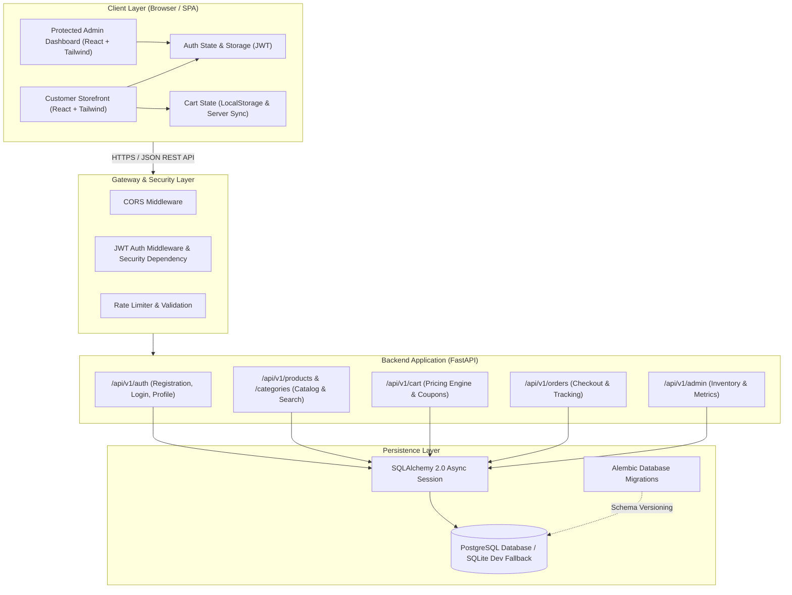

# FTS Store — Technical Architecture Document

**System**: FTS Store (Frnds Tech Solution)  
**Document Version**: 2.0.0 (Production Architecture)  
**Authors**: Senior Full-Stack Software Architect & DevOps Lead  

---

## 1. High-Level Architecture Overview

FTS Store follows a decoupled, API-first client-server architecture. The frontend is a Single Page Application (SPA) powered by **React 18+, Vite, TypeScript, and Tailwind CSS**. The backend is an asynchronous, high-throughput RESTful service powered by **Python, FastAPI, and SQLAlchemy 2.0 ORM**, backed by a relational database (**PostgreSQL** in staging/production, with **SQLite** zero-setup compatibility for local development).



---

## 2. Frontend Architecture (React + Vite + TypeScript + Tailwind)

### 2.1 Technology Choices & Rationale
- **Vite**: Ultra-fast build times, instant HMR (Hot Module Replacement), optimized production bundle splitting.
- **TypeScript 5+**: End-to-end type safety, eliminating runtime null pointer and schema mismatch errors.
- **Tailwind CSS**: Utility-first CSS ensuring design consistency, zero runtime CSS overhead, responsive breakpoints, and dark mode support.
- **Lucide React / SVG Icons**: Lightweight, scalable, accessible iconography.

### 2.2 Directory Structure
```
frontend/
├── public/                 # Static assets, favicon, manifest
├── src/
│   ├── assets/             # Brand logos, placeholder graphics
│   ├── components/         # Reusable presentation components
│   │   ├── common/         # Button, Input, Modal, Toast, Badge, Spinner
│   │   ├── layout/         # Header, Footer, Navbar, AdminSidebar
│   │   ├── product/        # ProductCard, ProductGrid, ProductFilter, QuickView
│   │   └── cart/           # CartDrawer, CartItemRow, ShippingProgressBar
│   ├── context/            # React Context providers (AuthContext, CartContext, ThemeContext)
│   ├── hooks/              # Custom hooks (useAuth, useCart, useProducts, useDebounce)
│   ├── layouts/            # StorefrontLayout, AdminLayout, AuthLayout
│   ├── pages/              # Route views
│   │   ├── storefront/     # HomePage, CatalogPage, ProductDetailPage, CheckoutPage
│   │   ├── customer/       # CustomerOrdersPage, CustomerProfilePage
│   │   ├── admin/          # AdminDashboardPage, AdminProductsPage, AdminOrdersPage
│   │   └── auth/           # LoginPage, RegisterPage
│   ├── routes/             # React Router config, ProtectedRoute, AdminRoute guards
│   ├── services/           # Type-safe Axios/Fetch API client modules
│   │   ├── api.ts          # Central client with JWT request interceptor
│   │   ├── authService.ts
│   │   ├── productService.ts
│   │   └── orderService.ts
│   ├── types/              # Shared TypeScript interfaces (User, Product, Order, Cart)
│   ├── utils/              # Currency formatters, date parsers, validator helpers
│   ├── App.tsx             # Root route tree and context provider composition
│   ├── index.css           # Tailwind base, components, and utility directives
│   └── main.tsx            # DOM mount entrypoint
├── index.html              # HTML5 entrypoint with SEO meta tags
├── package.json
├── tailwind.config.js      # Custom theme colors, fonts, and animation extensions
├── tsconfig.json           # Strict TypeScript configuration
└── vite.config.ts          # Vite build, proxy, and path alias configuration
```

### 2.3 Route Guard Architecture
- **Public Routes**: `/`, `/products`, `/products/:id`, `/cart`, `/login`, `/register`.
- **Customer Protected Routes**: `/account`, `/account/orders`, `/checkout`. Redirects to `/login?redirect=...` if unauthenticated.
- **Admin Protected Routes**: `/admin`, `/admin/products`, `/admin/orders`, `/admin/analytics`. Checks `user.role === 'admin'`; redirects unauthorized users to `/` with a 403 alert.

---

## 3. Backend Architecture (Python FastAPI + SQLAlchemy 2.0)

### 3.1 Layered Architecture Pattern
The backend is structured in strictly isolated architectural layers:

```
┌────────────────────────────────────────────────────────┐
│  API Routers (HTTP endpoints, validation, serialization)│
└───────────────────────────┬────────────────────────────┘
                            │
┌───────────────────────────▼────────────────────────────┐
│  Service Layer (Business rules, transactions, workflows)│
└───────────────────────────┬────────────────────────────┘
                            │
┌───────────────────────────▼────────────────────────────┐
│  Data Layer (SQLAlchemy ORM models, repository queries) │
└───────────────────────────┬────────────────────────────┘
                            │
┌───────────────────────────▼────────────────────────────┐
│  Database (PostgreSQL / SQLite with connection pooling)│
└────────────────────────────────────────────────────────┘
```

### 3.2 Directory Structure
```
backend/
├── app/
│   ├── api/
│   │   ├── deps.py         # Dependencies: get_db, get_current_user, require_admin
│   │   └── v1/
│   │       ├── api.py      # Main router aggregator mounting all v1 routes
│   │       ├── endpoints/
│   │       │   ├── auth.py       # Login, register, profile
│   │       │   ├── products.py   # Product listing, detail, search
│   │       │   ├── categories.py # Category CRUD
│   │       │   ├── cart.py       # Cart calculator and coupon validation
│   │       │   ├── orders.py     # Order placement and tracking
│   │       │   └── admin.py      # Admin metrics, product & order management
│   ├── core/
│   │   ├── config.py       # Pydantic Settings (.env management)
│   │   ├── security.py     # Password hashing (bcrypt) and JWT encode/decode
│   │   └── exceptions.py   # Domain exceptions and error handlers
│   ├── db/
│   │   ├── base.py         # Declarative Base for models
│   │   ├── session.py      # SQLAlchemy engine and session factory
│   │   └── init_db.py      # Seed script for initial categories, products, admin
│   ├── models/             # SQLAlchemy ORM database models
│   │   ├── user.py
│   │   ├── product.py
│   │   ├── category.py
│   │   ├── order.py
│   │   ├── cart.py
│   │   └── coupon.py
│   ├── schemas/            # Pydantic v2 models (validation, request, response)
│   │   ├── user.py
│   │   ├── product.py
│   │   ├── order.py
│   │   └── cart.py
│   ├── services/           # Reusable business logic services
│   │   ├── auth_service.py
│   │   ├── product_service.py
│   │   ├── cart_service.py
│   │   └── order_service.py
│   └── main.py             # FastAPI app factory, CORS, exception handlers
├── alembic/                # Database migrations
│   ├── versions/
│   └── env.py
├── alembic.ini
├── requirements.txt        # Production & testing dependencies
└── run.py                  # CLI runner script
```

---

## 4. Security Architecture

1. **Authentication Token Lifecycle**:
   - Access token: HMAC-SHA256 signed JWT, 60-minute expiration. Contains `{ "sub": user_id, "role": user_role, "exp": expiration }`.
   - Passwords hashed using `passlib[bcrypt]` with salt.
2. **Authorization Guards**:
   - `get_current_user`: extracts Bearer token, decodes JWT, verifies signature, loads active user from DB.
   - `require_admin`: verifies that `current_user.role == "admin"`, raising `403 Forbidden` if customer.
3. **CORS Hardening**:
   - Controlled via `CORS_ORIGINS` in `.env`. Credentials allowed only for whitelisted development/production domains.
4. **Input Sanitization & Injection Prevention**:
   - SQLAlchemy parameterized queries eliminate SQL injection vulnerabilities.
   - Pydantic v2 strict type validation prevents mass-assignment and buffer overflows.

---

## 5. Reliability & Transaction Management

- **Atomic Inventory Updates**: Product stock decrement is wrapped in an explicit database transaction context:
  ```python
  async with session.begin():
      product = await get_product_for_update(db, item.product_id)
      if product.stock < item.quantity:
          raise InsufficientStockError()
      product.stock -= item.quantity
      order = create_order(db, ...)
  ```
- If payment simulation fails or an exception occurs, the transaction rolls back cleanly, ensuring no orphaned inventory or phantom orders.
