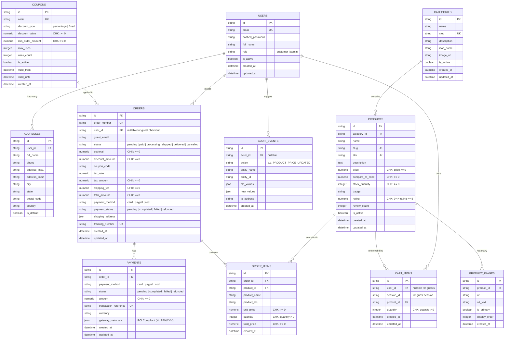

# FTS Store — Database Design & Schema Specification

**System**: FTS Store (Frnds Tech Solution)  
**Target RDBMS**: PostgreSQL 15+ (Staging / Production) & SQLite 3 (Local Development Fallback)  
**ORM**: SQLAlchemy 2.0 (Declarative Base)  
**Migration Tool**: Alembic (Revision: `a67dd0b0425e`)  
**Status**: Implemented & Verified  

---

## 1. Entity Relationship Diagram (ERD)

---

## 2. Detailed Table Specifications & Constraints

### 2.1 Table: `users`
Represents registered customers and administrative staff.

| Column | Type | Constraints | Description |
|---|---|---|---|
| `id` | VARCHAR(36) | PRIMARY KEY, UUIDv4 | Unique user ID |
| `email` | VARCHAR(255) | UNIQUE, NOT NULL, INDEXED | User email address (login credential) |
| `hashed_password` | VARCHAR(255) | NOT NULL | Bcrypt hashed password |
| `full_name` | VARCHAR(150) | NOT NULL | Customer's full display name |
| `role` | VARCHAR(20) | NOT NULL, DEFAULT 'customer' | Role: `customer` or `admin` (Enum) |
| `is_active` | BOOLEAN | NOT NULL, DEFAULT TRUE | Soft-delete / account lock flag |
| `created_at` | TIMESTAMP WITH TIME ZONE | NOT NULL, DEFAULT utcnow | Account creation timestamp |
| `updated_at` | TIMESTAMP WITH TIME ZONE | NOT NULL, DEFAULT utcnow, onupdate | Profile update timestamp |

### 2.2 Table: `addresses`
Saved shipping and billing destinations.

| Column | Type | Constraints | Description |
|---|---|---|---|
| `id` | VARCHAR(36) | PRIMARY KEY, UUIDv4 | Unique address ID |
| `user_id` | VARCHAR(36) | FOREIGN KEY (`users.id`) ON DELETE CASCADE, NOT NULL, INDEXED | User link |
| `full_name` | VARCHAR(150) | NOT NULL | Recipient name |
| `phone` | VARCHAR(50) | NULLABLE | Recipient contact phone |
| `address_line1` | VARCHAR(255) | NOT NULL | Street address |
| `address_line2` | VARCHAR(255) | NULLABLE | Suite / Apt / Unit |
| `city` | VARCHAR(100) | NOT NULL | City |
| `state` | VARCHAR(100) | NULLABLE | State / Province |
| `postal_code` | VARCHAR(30) | NOT NULL | ZIP / Postal code |
| `country` | VARCHAR(100) | NOT NULL, DEFAULT 'United States' | Country |
| `is_default` | BOOLEAN | NOT NULL, DEFAULT FALSE | Default shipping address flag |
| `created_at` | TIMESTAMP WITH TIME ZONE | NOT NULL, DEFAULT utcnow | Creation timestamp |
| `updated_at` | TIMESTAMP WITH TIME ZONE | NOT NULL, DEFAULT utcnow, onupdate | Update timestamp |

### 2.3 Table: `categories`
Hierarchical catalog classification.

| Column | Type | Constraints | Description |
|---|---|---|---|
| `id` | VARCHAR(36) | PRIMARY KEY, UUIDv4 | Unique category identifier |
| `name` | VARCHAR(100) | NOT NULL | Display name |
| `slug` | VARCHAR(120) | UNIQUE, NOT NULL, INDEXED | URL-safe slug (e.g. "electronics") |
| `description` | TEXT | NULLABLE | Category description |
| `icon_name` | VARCHAR(50) | NULLABLE | Icon identifier for UI render |
| `image_url` | VARCHAR(500) | NULLABLE | Category banner image URL |
| `is_active` | BOOLEAN | NOT NULL, DEFAULT TRUE | Category visibility toggle |
| `created_at` | TIMESTAMP WITH TIME ZONE | NOT NULL, DEFAULT utcnow | Creation timestamp |
| `updated_at` | TIMESTAMP WITH TIME ZONE | NOT NULL, DEFAULT utcnow, onupdate | Update timestamp |

### 2.4 Table: `products`
Product catalog master table.

| Column | Type | Constraints | Description |
|---|---|---|---|
| `id` | VARCHAR(36) | PRIMARY KEY, UUIDv4 | Unique product ID |
| `category_id` | VARCHAR(36) | FOREIGN KEY (`categories.id`) ON DELETE RESTRICT, NOT NULL, INDEXED | Category link |
| `name` | VARCHAR(255) | NOT NULL, INDEXED | Full product title |
| `slug` | VARCHAR(280) | UNIQUE, NOT NULL, INDEXED | URL slug |
| `sku` | VARCHAR(80) | UNIQUE, NOT NULL, INDEXED | Stock Keeping Unit |
| `description` | TEXT | NOT NULL | Full product description |
| `price` | NUMERIC(10, 2) | NOT NULL, CHECK (`price >= 0`) | Decimal-safe selling price |
| `compare_at_price` | NUMERIC(10, 2) | NULLABLE, CHECK (`compare_at_price >= 0`) | MSRP price for strike-through |
| `stock_quantity` | INTEGER | NOT NULL, DEFAULT 0, CHECK (`stock_quantity >= 0`) | Available warehouse stock |
| `badge` | VARCHAR(50) | NULLABLE | Tag (e.g. "Best Seller", "Trending") |
| `rating` | NUMERIC(3, 2) | NOT NULL, DEFAULT 5.0, CHECK (`0 <= rating <= 5`) | Average rating |
| `review_count` | INTEGER | NOT NULL, DEFAULT 0 | Count of customer reviews |
| `is_active` | BOOLEAN | NOT NULL, DEFAULT TRUE, INDEXED | Active catalog status |
| `created_at` | TIMESTAMP WITH TIME ZONE | NOT NULL, DEFAULT utcnow | Added to catalog timestamp |
| `updated_at` | TIMESTAMP WITH TIME ZONE | NOT NULL, DEFAULT utcnow, onupdate | Last modified timestamp |

### 2.5 Table: `product_images`
Product media gallery entries.

| Column | Type | Constraints | Description |
|---|---|---|---|
| `id` | VARCHAR(36) | PRIMARY KEY, UUIDv4 | Unique image record ID |
| `product_id` | VARCHAR(36) | FOREIGN KEY (`products.id`) ON DELETE CASCADE, NOT NULL, INDEXED | Parent product link |
| `url` | VARCHAR(500) | NOT NULL | Image asset URL |
| `alt_text` | VARCHAR(255) | NULLABLE | Image accessibility label |
| `is_primary` | BOOLEAN | NOT NULL, DEFAULT FALSE | Thumbnail image selector |
| `display_order` | INTEGER | NOT NULL, DEFAULT 0 | Ordering index |
| `created_at` | TIMESTAMP WITH TIME ZONE | NOT NULL, DEFAULT utcnow | Creation timestamp |

### 2.6 Table: `cart_items`
Persistent user and guest cart items.

| Column | Type | Constraints | Description |
|---|---|---|---|
| `id` | VARCHAR(36) | PRIMARY KEY, UUIDv4 | Unique cart item ID |
| `user_id` | VARCHAR(36) | FOREIGN KEY (`users.id`) ON DELETE CASCADE, NULLABLE, INDEXED | Authenticated user link |
| `session_id` | VARCHAR(100) | NULLABLE, INDEXED | Guest session identifier |
| `product_id` | VARCHAR(36) | FOREIGN KEY (`products.id`) ON DELETE CASCADE, NOT NULL, INDEXED | Product in cart |
| `quantity` | INTEGER | NOT NULL, DEFAULT 1, CHECK (`quantity > 0`) | Positive quantity |
| `created_at` | TIMESTAMP WITH TIME ZONE | NOT NULL, DEFAULT utcnow | Added timestamp |
| `updated_at` | TIMESTAMP WITH TIME ZONE | NOT NULL, DEFAULT utcnow, onupdate | Modified timestamp |

*Check Constraint*: `user_id IS NOT NULL OR session_id IS NOT NULL`.

### 2.7 Table: `orders`
Immutable customer order headers.

| Column | Type | Constraints | Description |
|---|---|---|---|
| `id` | VARCHAR(36) | PRIMARY KEY, UUIDv4 | Internal order ID |
| `order_number` | VARCHAR(40) | UNIQUE, NOT NULL, INDEXED | Human-readable ID (`FTS-ORD-XXXX`) |
| `user_id` | VARCHAR(36) | FOREIGN KEY (`users.id`) ON DELETE SET NULL, NULLABLE, INDEXED | Customer link |
| `guest_email` | VARCHAR(255) | NULLABLE | Guest checkout contact email |
| `status` | VARCHAR(30) | NOT NULL, DEFAULT 'pending', INDEXED | Status: `pending`, `paid`, `processing`, `shipped`, `delivered`, `cancelled` |
| `subtotal` | NUMERIC(10, 2) | NOT NULL, CHECK (`subtotal >= 0`) | Item price sum before discounts |
| `discount_amount` | NUMERIC(10, 2) | NOT NULL, DEFAULT 0.00, CHECK (`discount_amount >= 0`) | Applied coupon discount |
| `coupon_code` | VARCHAR(50) | NULLABLE | Applied coupon promo code |
| `tax_rate` | NUMERIC(5, 4) | NOT NULL, DEFAULT 0.0800 | Applied sales tax rate (8%) |
| `tax_amount` | NUMERIC(10, 2) | NOT NULL, DEFAULT 0.00, CHECK (`tax_amount >= 0`) | Calculated sales tax |
| `shipping_fee` | NUMERIC(10, 2) | NOT NULL, DEFAULT 0.00, CHECK (`shipping_fee >= 0`) | Shipping cost |
| `total_amount` | NUMERIC(10, 2) | NOT NULL, CHECK (`total_amount >= 0`) | Final invoice total |
| `payment_method` | VARCHAR(40) | NOT NULL | `card`, `paypal`, or `cod` |
| `payment_status` | VARCHAR(30) | NOT NULL, DEFAULT 'pending' | `pending`, `completed`, `failed`, `refunded` |
| `shipping_address` | JSON | NOT NULL | Snapshot of recipient, address, phone |
| `tracking_number` | VARCHAR(60) | UNIQUE, NULLABLE, INDEXED | Carrier tracking number (`FTS-TRK-XXXX`) |
| `created_at` | TIMESTAMP WITH TIME ZONE | NOT NULL, DEFAULT utcnow, INDEXED | Order timestamp |
| `updated_at` | TIMESTAMP WITH TIME ZONE | NOT NULL, DEFAULT utcnow, onupdate | Status update timestamp |

### 2.8 Table: `order_items`
Snapshot line items for completed orders.

| Column | Type | Constraints | Description |
|---|---|---|---|
| `id` | VARCHAR(36) | PRIMARY KEY, UUIDv4 | Unique line-item ID |
| `order_id` | VARCHAR(36) | FOREIGN KEY (`orders.id`) ON DELETE CASCADE, NOT NULL, INDEXED | Parent order link |
| `product_id` | VARCHAR(36) | FOREIGN KEY (`products.id`) ON DELETE SET NULL, NULLABLE, INDEXED | Product reference |
| `product_name` | VARCHAR(255) | NOT NULL | Snapshot of product name at purchase |
| `product_sku` | VARCHAR(80) | NOT NULL | Snapshot of product SKU |
| `unit_price` | NUMERIC(10, 2) | NOT NULL, CHECK (`unit_price >= 0`) | Snapshot of unit price at purchase |
| `quantity` | INTEGER | NOT NULL, CHECK (`quantity > 0`) | Quantity purchased |
| `total_price` | NUMERIC(10, 2) | NOT NULL, CHECK (`total_price >= 0`) | Snapshot `unit_price * quantity` |
| `created_at` | TIMESTAMP WITH TIME ZONE | NOT NULL, DEFAULT utcnow | Snapshot creation timestamp |

### 2.9 Table: `coupons`
Promotional discount codes.

| Column | Type | Constraints | Description |
|---|---|---|---|
| `id` | VARCHAR(36) | PRIMARY KEY, UUIDv4 | Unique coupon ID |
| `code` | VARCHAR(50) | UNIQUE, NOT NULL, INDEXED | Uppercase code (e.g. `WELCOME10`) |
| `discount_type` | VARCHAR(20) | NOT NULL, DEFAULT 'percentage' | `percentage` or `fixed` |
| `discount_value` | NUMERIC(10, 2) | NOT NULL, CHECK (`discount_value >= 0`) | Percentage or Dollar amount |
| `min_order_amount`| NUMERIC(10, 2) | NOT NULL, DEFAULT 0.00, CHECK (`min_order_amount >= 0`) | Minimum subtotal required |
| `max_uses` | INTEGER | NULLABLE | Maximum lifetime redemptions |
| `uses_count` | INTEGER | NOT NULL, DEFAULT 0 | Count of times redeemed |
| `is_active` | BOOLEAN | NOT NULL, DEFAULT TRUE | Active toggle |
| `valid_from` | TIMESTAMP WITH TIME ZONE | NULLABLE | Start timestamp |
| `valid_until` | TIMESTAMP WITH TIME ZONE | NULLABLE | Expiration timestamp |
| `created_at` | TIMESTAMP WITH TIME ZONE | NOT NULL, DEFAULT utcnow | Creation timestamp |

### 2.10 Table: `payments`
Encrypted transaction receipts for order settlements.

| Column | Type | Constraints | Description |
|---|---|---|---|
| `id` | VARCHAR(36) | PRIMARY KEY, UUIDv4 | Unique payment transaction ID |
| `order_id` | VARCHAR(36) | FOREIGN KEY (`orders.id`) ON DELETE CASCADE, NOT NULL, INDEXED | Order reference |
| `payment_method` | VARCHAR(40) | NOT NULL | `card`, `paypal`, or `cod` |
| `status` | VARCHAR(30) | NOT NULL, DEFAULT 'pending' | `pending`, `completed`, `failed`, `refunded` |
| `amount` | NUMERIC(10, 2) | NOT NULL, CHECK (`amount >= 0`) | Paid decimal amount |
| `transaction_reference` | VARCHAR(100) | UNIQUE, NULLABLE, INDEXED | Gateway reference ID |
| `currency` | VARCHAR(10) | NOT NULL, DEFAULT 'USD' | Currency code |
| `gateway_metadata` | JSON | NULLABLE | Safe gateway audit payload (NO PAN/CVV!) |
| `created_at` | TIMESTAMP WITH TIME ZONE | NOT NULL, DEFAULT utcnow | Settlement timestamp |
| `updated_at` | TIMESTAMP WITH TIME ZONE | NOT NULL, DEFAULT utcnow, onupdate | Status timestamp |

### 2.11 Table: `audit_events`
Audit trails for sensitive administrative actions.

| Column | Type | Constraints | Description |
|---|---|---|---|
| `id` | VARCHAR(36) | PRIMARY KEY, UUIDv4 | Unique audit log ID |
| `actor_id` | VARCHAR(36) | FOREIGN KEY (`users.id`) ON DELETE SET NULL, NULLABLE, INDEXED | Administrative user performing action |
| `action` | VARCHAR(80) | NOT NULL, INDEXED | e.g. `PRODUCT_PRICE_UPDATED`, `STOCK_ADJUSTED` |
| `entity_name` | VARCHAR(80) | NOT NULL | Affected entity (e.g. `Product`, `Order`) |
| `entity_id` | VARCHAR(80) | NOT NULL, INDEXED | Affected entity ID |
| `old_values` | JSON | NULLABLE | State before update |
| `new_values` | JSON | NULLABLE | State after update |
| `ip_address` | VARCHAR(50) | NULLABLE | Origin IP address |
| `created_at` | TIMESTAMP WITH TIME ZONE | NOT NULL, DEFAULT utcnow, INDEXED | Event timestamp |

---

## 3. Justified Design Changes & Implementation Verification

1. **Addition of `payments` Table**:
   - *Rationale*: Segregates payment lifecycle and gateway transaction references from general order header details. Strictly adheres to PCI-DSS by excluding credit card primary account numbers (PAN) and CVVs.
2. **Addition of `audit_events` Table**:
   - *Rationale*: Provides immutable compliance logging for sensitive administrative operations such as product price overrides, manual inventory changes, and order status updates.
3. **Explicit Database Check Constraints**:
   - Enforced non-negative monetary amounts (`price >= 0`, `total_amount >= 0`), positive quantities (`quantity > 0`), valid ratings (`0 <= rating <= 5`), and non-negative warehouse inventory (`stock_quantity >= 0`).
4. **Historical Price Snapshotting**:
   - Verified that subsequent product price modifications do not alter `order_items.unit_price` on already completed orders.
5. **Alembic Migration (`a67dd0b0425e_create_initial_fts_store_schema.py`)**:
   - Autogenerated and applied successfully (`alembic upgrade head`).
6. **Idempotent Development Seeding (`app.db.seed`)**:
   - Verified that executing the seed script multiple times produces zero duplicate records (`0 created` on subsequent runs).
